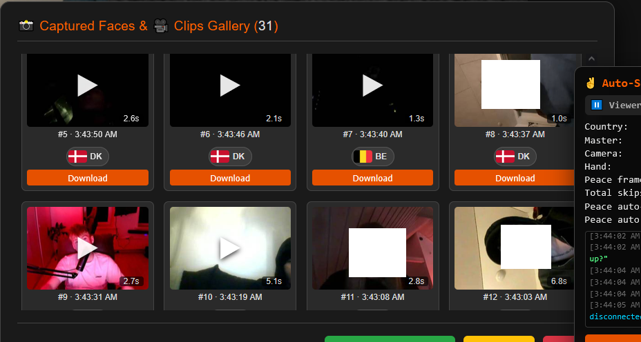
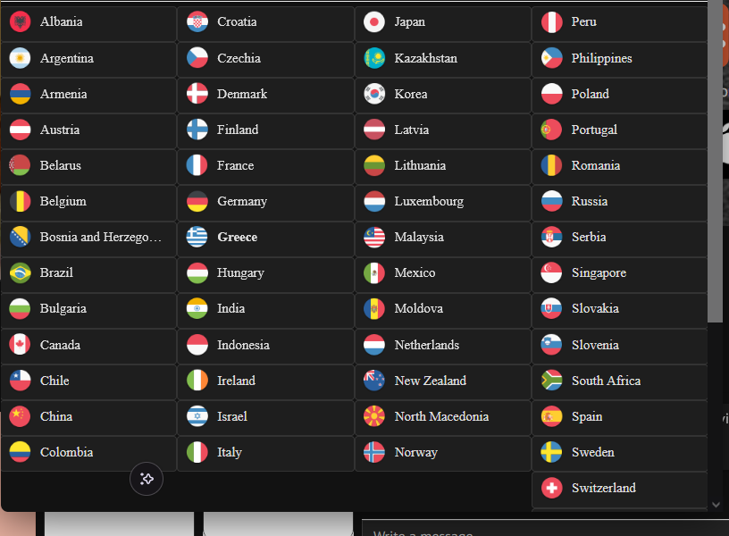

  
  
  
  
  
  
   
  

  <b>OmePilot is the autopilot for Ome.tv.</b> Skip who you don't want, greet who you do, save faces to a gallery, and record every chat as a clip — automatically. 
  ⭐ <b>Like it? <a href="https://github.com/JohnHansonTheDev/omepilot">Star the repo</a> so others can find it.</b>

  <a href="#install-no-tampermonkey-needed">Install</a> •
  <a href="#options">Options</a> •
  <a href="#screenshots">Screenshots</a> •
  <a href="https://github.com/JohnHansonTheDev/omepilot/releases">Releases</a> •
  <a href="https://github.com/JohnHansonTheDev/omepilot/issues">Report a bug</a>

---

## Install (no Tampermonkey needed)

**1. Download**
- Here: click **Code → Download ZIP** and unzip, **or**
- Faster: grab `omepilot-extension.zip` from the [**latest release**](https://github.com/JohnHansonTheDev/omepilot/releases) and unzip it.

**2a. Chrome**
1. Open `chrome://extensions`.
2. Turn on **Developer mode** (top right).
3. Click **Load unpacked** and select the `extension` folder.

**2b. Firefox**
1. Open `about:debugging#/runtime/this-firefox`.
2. Click **Load Temporary Add-on**.
3. Select the file `extension/manifest.json`.

**Alternative: Tampermonkey**
1. Install [Tampermonkey](https://www.tampermonkey.net/).
2. Create a new userscript and paste the whole [`omepilot.user.js`](omepilot.user.js) file.
3. Save and open `ome.tv`.

Updates are automatic: OmePilot checks this repo for new versions and tells you inside the app when one drops.

## First run

1. Open [ome.tv](https://ome.tv) and click **Start**.
2. Click the orange **⚙️ button** (bottom left) for settings. Turn on what you want, press **Save**.
3. The **Auto-Skip Panel** (bottom right) shows everything live.

## Options

### Look & layout
- **Dark Mode** — dark theme for the whole site.
- **Enable Drag & Resize Tools** — hovering any video shows move / reset / resize handles. Positions are remembered next visit.
- **↺ Reset Video Positions** — puts all videos back where they started.
- **Show Debug Panel** — shows or hides the Auto-Skip Panel.

### Hotkeys
- **Skip / Start Key** (default `d`) — next person.
- **Stop Key** (default `s`) — stop chatting.
- **Pause / Resume Key** (default `x`) — freezes and unfreezes everything. Same as the **Pause All** button.

### Skip filters (each can be on/off)
- **✌️ Peace Auto Skip** — show a peace sign to your own camera and it skips to the next person.
- **♂️ Male Auto Skip** — skips men automatically.
- **😶 No Face Auto Skip** — skips when nobody's face is visible.
  - **No-Face Time** — how many seconds of no face before it skips (1–10).
- **❄️ Frozen Camera Skip** — skips when the other person's picture is frozen.
- **⬛ Black Screen Skip** — skips when their camera is covered or black.
- **🌍 Country Auto Skip** — skips people from countries you picked. Press **Configure Country Skip List** to tick countries, or type any 2-letter code (e.g. `XK`) and press **+ Add custom code**. The panel always shows the current person's country so you can check it's reading the right one.

### Greeting
- **💬 Female Auto-Msg** — the message sent automatically when the other person is a woman. Type anything you want.
- **⏸️ Pause after Female** — pauses everything right after sending the greeting so you can chat yourself.

### Gallery
- **📸 Save Mode (Face Snap)** — saves a photo of every person into the gallery, tagged with their country flag.
- **📸 Gallery button** (in the panel) — opens everything you captured. Click to enlarge/play, **Download** for one item, **Download All** for a zip, **Clear All** to wipe them.
- If someone sends chat messages, their capture gets a red border and a **View Text** button.

### 🎥 Video recording (new in v8.9)
- **🎥 Record Mode (Full Video)** — records each person you talk to as a separate clip, automatically — no manual clicking.
- Every clip gets a **real thumbnail**, its **length**, the **country flag** and the exact **time** it was taken.
- Click a clip for the **fullscreen player** with native controls. Close it with the **✕** in the video's top-right corner, click **anywhere outside the video**, or press **Esc**.
- **↳ Max clip** — longest a single clip can run (15–600s).
- **↳ Keep last** — how many clips to keep; the oldest drop off automatically (5–100).
- Clips download as `.webm` with a fixed duration, so they seek and show the correct total time in any player.

### Auto-Skip Panel
- **Country** — who you're connected to right now.
- **Master** — ACTIVE means automation is on, PAUSED means off.
- **Camera / Hand / Peace frames** — live status of your own camera.
- **Total skips** — how many skips this session.
- **Log** — timestamped feed of everything OmePilot does.
- **Pause All / Resume All, Enable/Disable Peace, Clear Logs** — quick controls.

### Updates
- **⬆️ Check for Updates** (in settings) — compares your version against this repo on demand. The daily automatic check does the rest.

## Screenshots

### Block countries

### Settings

### Save faces instantly into the gallery

### Video recording — faces & clips gallery

## Extras

### 🚩 Country overlay fix (separate script)

Ome.tv's own **country-filter popup** can render off-screen or half-cut when it opens over the dimmed background, leaving a stray panel behind the page. This is a tiny **standalone** userscript that only fixes that popup — it lifts it onto the page body, centers it, keeps it inside the screen and gives it a scrollbar. It does **not** touch OmePilot, so both run side by side.

- With Tampermonkey: create a new userscript and paste [`extras/overlay-flag-fix.user.js`](extras/overlay-flag-fix.user.js), then save.
- Needs no settings — install and reload `ome.tv`.

## If the page feels slow

Turn filters off one at a time and see which one was the cause.

---

  Made for the Ome.tv community. If OmePilot saves you time, <a href="https://github.com/JohnHansonTheDev/omepilot">give it a ⭐</a> and share it. 
  ome.tv autopilot • omegle alternative • random video chat filter • country skip • auto skip • tampermonkey userscript • chrome extension • firefox add-on

