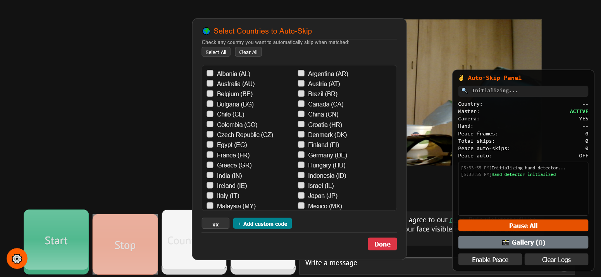
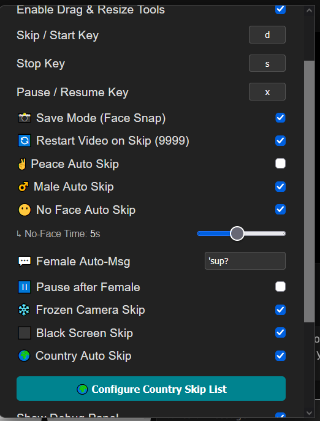
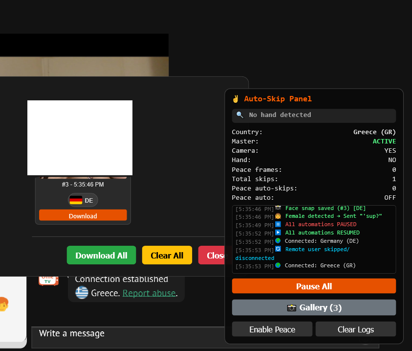

# OmePilot

OmePilot sits on top of Ome.tv and handles the boring stuff for you: skipping people you don't want to talk to, greeting the ones you do, and saving photos into a gallery.

## Install (no Tampermonkey needed)

**1. Download the extension folder**
- On this page click **Code → Download ZIP**, unzip it, and keep the `extension` folder.

**2a. Chrome**
1. Open `chrome://extensions`.
2. Turn on **Developer mode** (top right).
3. Click **Load unpacked** and select the `extension` folder.
4. Done — OmePilot is active on `ome.tv`.

**2b. Firefox**
1. Open `about:debugging#/runtime/this-firefox`.
2. Click **Load Temporary Add-on**.
3. Select the file `extension/manifest.json`.
4. Done — OmePilot is active on `ome.tv` until Firefox restarts (then just load it again).

**Alternative: Tampermonkey**
1. Install [Tampermonkey](https://www.tampermonkey.net/).
2. Create a new userscript and paste the whole [`omepilot.user.js`](omepilot.user.js) file.
3. Save and open `ome.tv`.

## First run

1. Open [ome.tv](https://ome.tv) and click **Start** to begin chatting.
2. Click the orange **⚙️ button** (bottom left) to open settings.
3. Turn on what you want, press **Save**.
4. The **Auto-Skip Panel** (bottom right) shows what's happening live.

## Options

### Look & layout
- **Dark Mode** — dark theme for the whole site.
- **Enable Drag & Resize Tools** — hovering any video shows move / reset / resize handles. Positions are remembered next visit.
- **↺ Reset Video Positions** — puts all videos back where they started.
- **Show Debug Panel** — shows or hides the Auto-Skip Panel.

### Hotkeys
- **Skip / Start Key** (default `d`) — next person.
- **Stop Key** (default `s`) — stop chatting.
- **Pause / Resume Key** (default `x`) — freezes and unfreezes everything. Same as the **Pause All** button.

### Skip filters (each can be on/off)
- **✌️ Peace Auto Skip** — show a peace sign to your own camera and it skips to the next person.
- **♂️ Male Auto Skip** — skips men automatically.
- **😶 No Face Auto Skip** — skips when nobody's face is visible.
  - **No-Face Time** — how many seconds of no face before it skips (1–10).
- **❄️ Frozen Camera Skip** — skips when the other person's picture is frozen.
- **⬛ Black Screen Skip** — skips when their camera is covered or black.
- **🌍 Country Auto Skip** — skips people from countries you picked. Press **Configure Country Skip List** to tick countries, or type any 2-letter code (e.g. `XK`) and press **+ Add custom code**. The panel always shows the current person's country so you can check it's reading the right one.

### Greeting
- **💬 Female Auto-Msg** — the message sent automatically when the other person is a woman. Type anything you want.
- **⏸️ Pause after Female** — pauses everything right after sending the greeting so you can chat yourself.

### Gallery
- **📸 Save Mode (Face Snap)** — saves a photo of every person into the gallery, tagged with their country flag.
- **📸 Gallery button** (in the panel) — opens all saved photos. Click a photo to enlarge it, **Download** for one photo, **Download All** for a zip of everything, **Clear All** to wipe them.
- If someone sends chat messages, their photo gets a red border and a **View Text** button.

### Auto-Skip Panel
- **Country** — who you're connected to right now.
- **Master** — ACTIVE means automation is on, PAUSED means off.
- **Camera / Hand / Peace frames** — live status of your own camera.
- **Total skips** — how many skips this session.
- **Log** — timestamped feed of everything OmePilot does.
- **Pause All / Resume All, Enable/Disable Peace, Clear Logs** — quick controls.

## Screenshots

### Block countries

### Settings

### Save faces instantly into the gallery

## If the page feels slow

Turn filters off one at a time and see which one was the cause — the hand/peace one is usually the heaviest.
